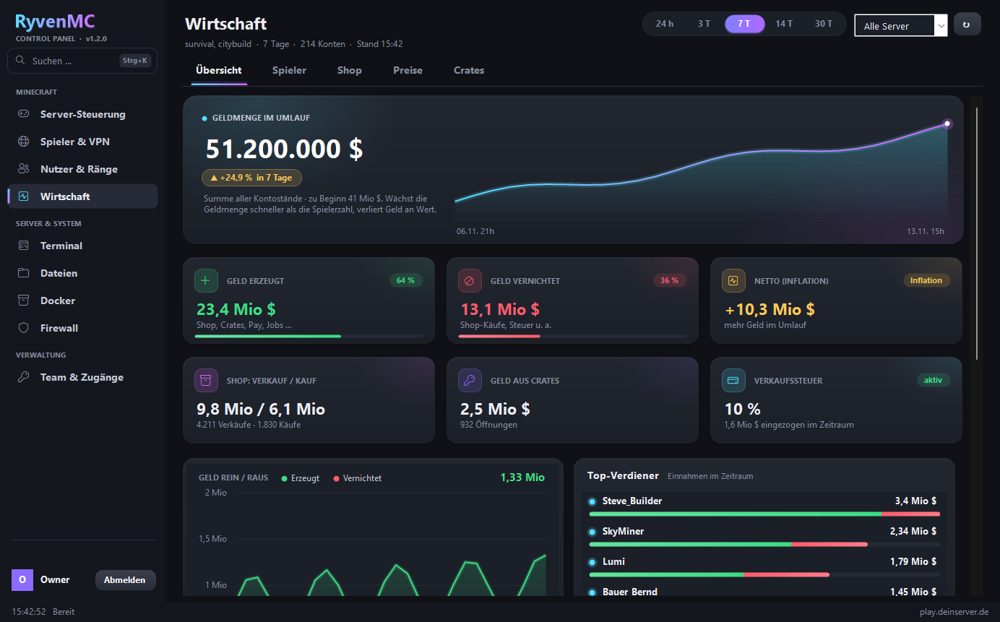
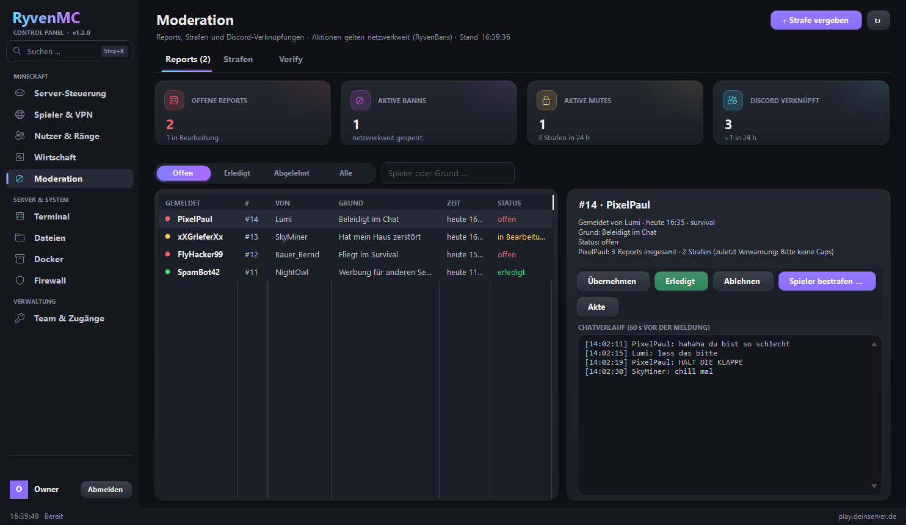
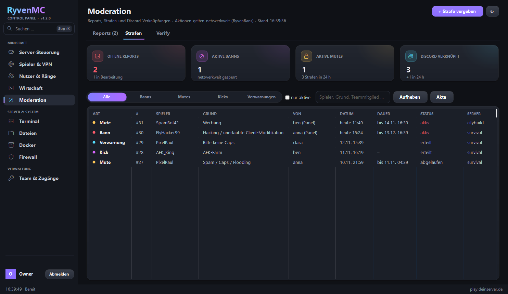
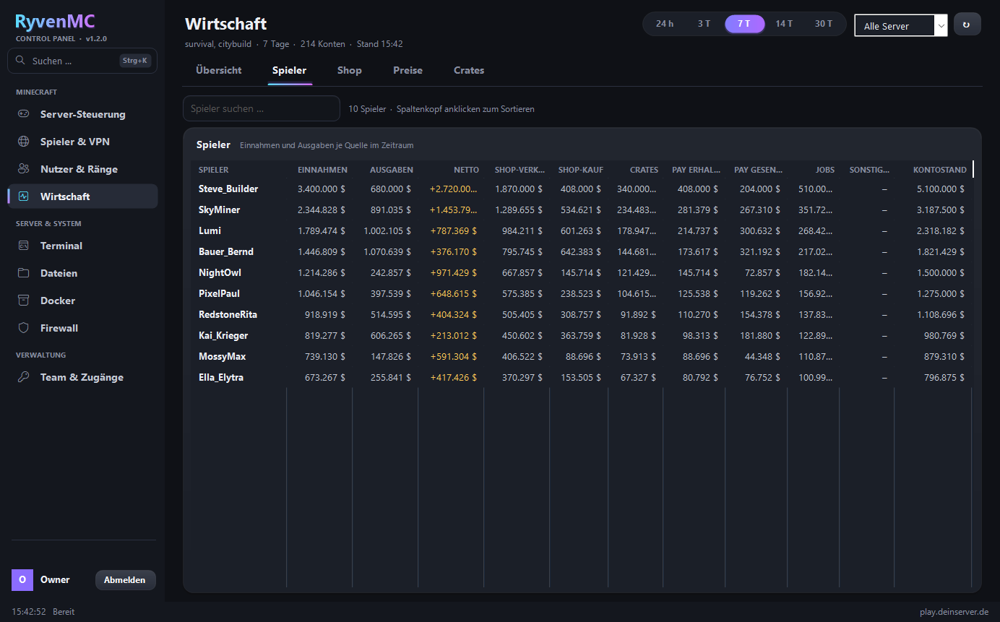
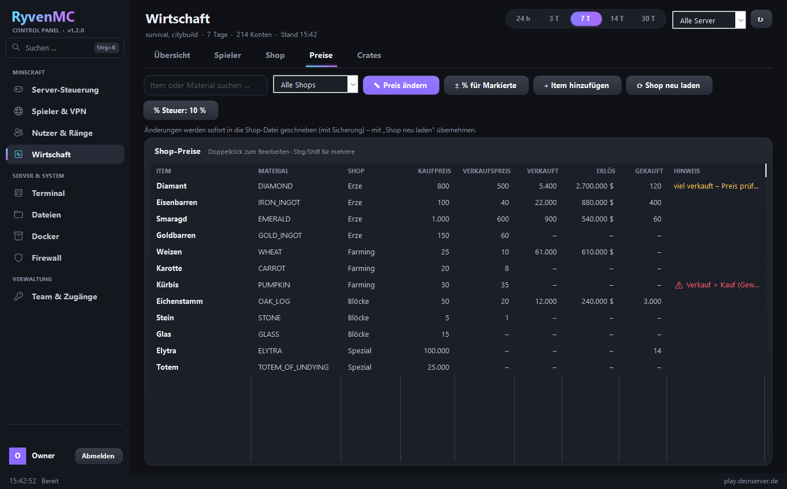
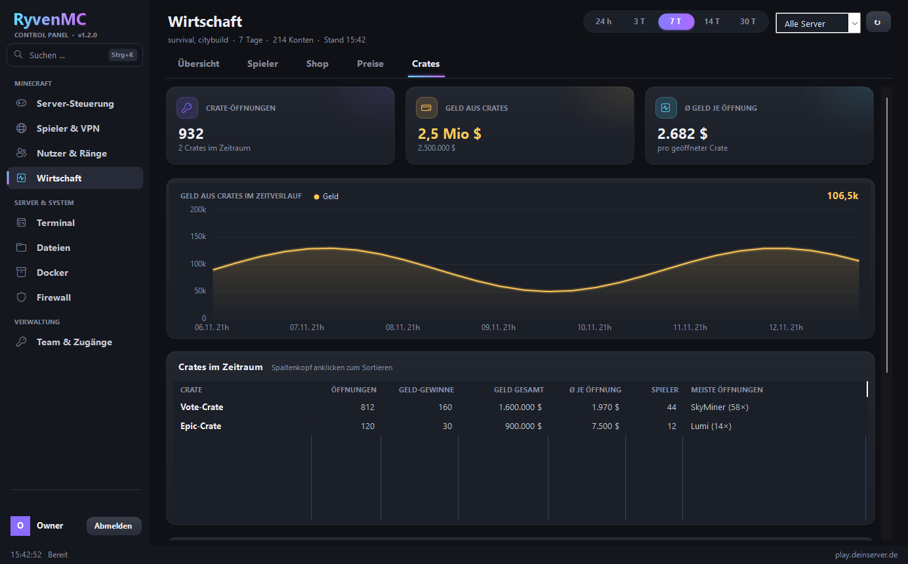
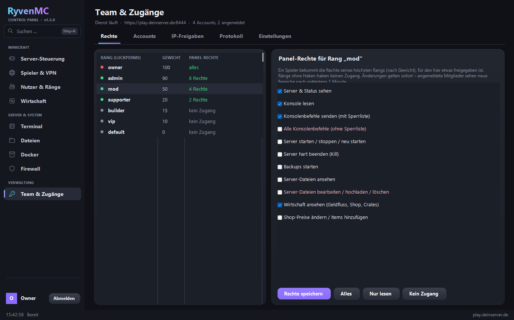
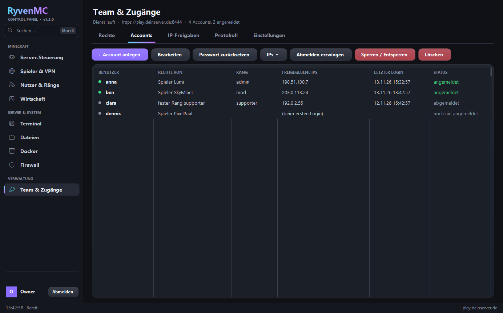
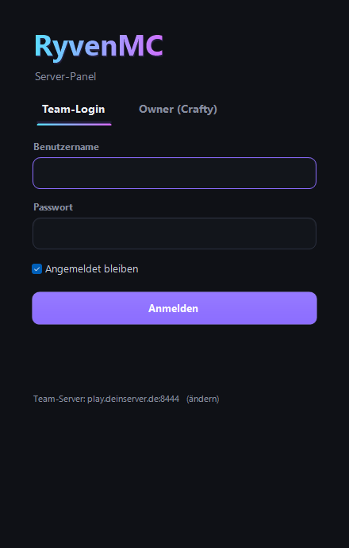
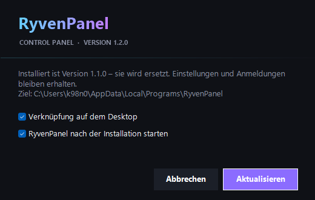

# RyvenPanel

**Kostenloses Windows-Control-Panel für Minecraft-Netzwerke mit [Crafty Controller](https://craftycontrol.com/).**
Ein Programm für alles, was man als Server-Owner täglich braucht – Server steuern, Spieler & Ränge verwalten,
Wirtschaft auswerten, Dateien, Terminal, Docker und Firewall – plus ein sicherer Zugang für dein Team.

> [!WARNING]
> **Dieses Panel ist speziell für das RyvenMC-Netzwerk angepasst – es ist kein Plug-and-Play-Panel für beliebige Server.**
>
> - **Ein KVM-Server ist Pflicht.** Du brauchst einen eigenen Linux-Server (KVM-VPS oder Root-Server) mit Root- und SSH-Zugriff.
>   Auf Minecraft-Hostern, Shared Hosting oder Webspace ohne Root/SSH funktioniert RyvenPanel **nicht**.
> - **Docker wird vorausgesetzt.** Crafty Controller und die Datenbank (MariaDB/MySQL) müssen als Docker-Container laufen.
> - **Eigene Plugins sind nötig, um an die Daten zu kommen.** Mehrere Bereiche lesen ihre Daten über eigene Plugins bzw. deren
>   Datenbank-Tabellen (z. B. *RyvenEco* für die Wirtschaft, LuckPerms mit MySQL für Ränge und Team-Rechte). Ohne diese Plugins
>   – oder eigene Plugins mit derselben Schnittstelle – bleiben diese Bereiche leer oder funktionieren nur eingeschränkt.
> - Pfade und Abläufe (z. B. `/opt/crafty/docker/servers`) sind auf den Aufbau von RyvenMC abgestimmt und müssen ggf. angepasst werden.
>
> Nutzung auf eigene Verantwortung, ohne Anspruch auf Support.

Entwickelt für das RyvenMC-Netzwerk, frei nutzbar für jeden (MIT-Lizenz).



## Download

👉 **[Neueste Version herunterladen](../../releases/latest)** – `RyvenPanel-Setup-x.y.z.exe` starten, fertig.

- Installation nur für den eigenen Windows-Benutzer, **keine Adminrechte** nötig
- Startmenü- und Desktop-Verknüpfung, Deinstallation über *Einstellungen → Apps*
- **Automatische Updates**: veröffentlicht der Owner eine neue Version, bekommt das ganze Team sie beim nächsten Start angeboten

## Funktionen

| Bereich | Was es kann |
|---|---|
| **Server-Steuerung** | Alle Crafty-Server mit Live-Status, Start/Stopp/Neustart, Backups, Konsole, Dateien, Metriken |
| **Spieler & VPN** | Wer ist online, Login-Verlauf, VPN/Proxy-Erkennung |
| **Nutzer & Ränge** | Money, Coins, LuckPerms-Ränge und Permissions, Bans |
| **Wirtschaft** | Geldmenge (Inflation), woher das Geld kommt, Top-Verdiener, Shop-Statistik, Preise ändern (EconomyShopGUI), Crate-Auswertung, Verkaufssteuer |
| **Moderation** | Reports mit Chatverlauf bearbeiten, alle Strafen (Bann, Mute, Kick, Verwarnung) mit Filter und Aufheben, Discord-Verknüpfungen, Spieler-Akte – Strafen netzwerkweit mit Vorlagen und Eskalation (RyvenBans) |
| **Terminal** | SSH-Konsole mit mehreren Tabs |
| **Dateien** | Datei-Manager für den ganzen Server (Upload/Download, Editor) |
| **Docker** | Container, Stacks, Images, Netzwerke |
| **Firewall** | Ports öffnen/schließen, IPs sperren (iptables) |
| **Team & Zugänge** | Team-Accounts mit Passwort, Rechte pro LuckPerms-Rang, IP-Freigaben, Protokoll |

## Screenshots

<sub>Alle Daten in den Bildern sind Beispieldaten.</sub>

| | |
|---|---|
| <br>**Moderation – Reports:** Meldung, Vorgeschichte und Chatverlauf, direkt bestrafen | <br>**Moderation – Strafen:** alle Banns, Mutes, Kicks und Verwarnungen netzwerkweit |
| <br>**Wirtschaft – Spieler:** Einnahmen und Ausgaben jedes Spielers nach Quelle | <br>**Shop-Preise:** Preise direkt ändern, Warnung bei Verkauf > Kauf |
| <br>**Crates:** Öffnungen, ausgeschüttetes Geld, häufigste Gewinne | <br>**Team-Rechte:** Panel-Rechte pro LuckPerms-Rang |
| <br>**Team-Accounts:** Logins, feste IPs, Status | <br>**Login:** Team-Login oder Owner über Crafty |

<p align="center"><br><b>Installer:</b> ohne Adminrechte, mit automatischen Updates</p>

### Team-Zugang
Teammitglieder bekommen **nie** deinen SSH-Schlüssel oder Crafty-Zugang. Ein kleiner Dienst auf dem Server
(`gateway/gateway.py`, wird aus dem Panel heraus installiert) prüft jede Aktion gegen die Rechte des Rangs,
bindet Accounts an IP-Adressen und protokolliert alles.

## API des Team-Dienstes (`gateway/gateway.py`)

HTTPS-Dienst auf dem Server (Standard-Port **8444**, eigenes Zertifikat, das das Panel fest kennt). Er ist der einzige Weg,
über den Team-Accounts etwas am Server tun – jede Anfrage wird gegen die Rechte des LuckPerms-Rangs geprüft und protokolliert.
Antworten sind JSON im Crafty-Stil: `{"status":"ok","data":…}` bzw. `{"status":"error","error":"CODE","error_data":"Text"}`.

**Anmeldung:** `POST /panel/login` mit `{"username","password"}` → Sitzungs-Token. Danach bei jeder Anfrage
`Authorization: Bearer <token>`. Login ist pro IP begrenzt (Sperre nach zu vielen Versuchen), Accounts können an IPs gebunden sein.

| Endpunkt | Recht | Zweck |
|---|---|---|
| `GET /panel/config` | – | Anmeldeart und Version des Dienstes |
| `GET /panel/update` · `GET /panel/update/RyvenPanel.exe` | – | Neueste Panel-Version (`version.json` mit SHA-256) und Download |
| `POST /panel/login` · `POST /panel/logout` | – / angemeldet | Sitzung starten / beenden |
| `GET /panel/me` | angemeldet | Eigener Account, Rang und **aktuelle** Rechte |
| `POST /panel/password` | angemeldet | Eigenes Passwort ändern (beim ersten Login Pflicht) |
| `POST /panel/eco` `{"cmd","args"}` | siehe unten | Wirtschaft (ruft `eco.py` auf dem Server auf) |
| `POST /panel/mod` `{"cmd","args"}` | siehe unten | Moderation (ruft `mod.py` auf, Daten aus RyvenLink/RyvenBans) |
| `/api/v2/…` | je nach Pfad | Durchreiche an die **Crafty-API** mit Rechteprüfung, siehe unten |

**Wirtschaft (`/panel/eco`):** `summary`, `items` → `economy.view` · `setprice`, `additem`, `reload`, `settax` → `economy.edit`.
Datenquellen: Tabellen `eco_tx` / `eco_supply` von **RyvenEco**, Kontostände, Crate-Öffnungen, Shop-Dateien.

**Moderation (`/panel/mod`):** `overview`, `reports`, `report`, `punishments`, `links`, `player`, `templates` → `moderation.view` ·
`report_set` → `moderation.reports` · `act` mit `action` = `warn|kick|mute|unmute` → `moderation.punish`, `ban|ipban|unban` → `moderation.ban`
(führt `ryvenbans exec …` auf dem Proxy aus).

**Crafty-Durchreiche (`/api/v2/servers/<id>/…`):**

| Pfad | Recht |
|---|---|
| `GET /api/v2/servers`, `GET …/<id>`, `…/stats`, `…/history` | `servers.view` |
| `GET …/logs` | `console.view` |
| `POST …/stdin` | `console.command` (Befehle auf der Sperrliste nur mit `console.command.unrestricted`) |
| `POST …/action/start_server\|stop_server\|restart_server` | `server.control` |
| `POST …/action/kill_server` | `server.kill` |
| `POST …/action/backup_server`, `GET …/backups` | `server.backup` |
| `POST …/files` (lesen) | `files.view` |
| `PUT/PATCH/DELETE …/files`, `…/files/…` | `files.edit` |

Alle anderen Pfade werden abgelehnt. **Owner-Verwaltung** (Accounts, Rang-Rechte, IP-Freigaben, Einstellungen) läuft nicht über HTTP,
sondern lokal per SSH: `python3 gateway.py admin <roles|user|ip|config> [base64-json]`.

## Voraussetzungen

**PC:** Windows 10/11 (.NET Framework 4.8 ist bereits enthalten). Für Terminal, Dateien, Docker, Firewall und
Wirtschaft den Windows-Client „OpenSSH“ (*Einstellungen → Optionale Features*).

**Server (Pflicht):**
- **KVM-Server** (VPS oder Root-Server) mit Linux, Root- und SSH-Zugriff
- **Docker** mit Crafty Controller 4 und MariaDB/MySQL als Container
- Python 3 für den Team-Zugang
- LuckPerms mit MySQL/MariaDB-Speicher
- Eigene Plugins für den Datenzugriff: **RyvenEco** (Wirtschafts-Auswertung) und **RyvenLink** mit RyvenBans (Reports, Strafen, Discord-Verify)

## Erste Schritte

1. **Owner:** Im Login-Fenster „Owner (Crafty)“ wählen, Crafty-Adresse (z. B. `https://dein-server:8443`) und Login eingeben.
2. Unter **Docker** einmal die SSH-Verbindung einrichten (Schlüssel wird erzeugt).
3. Unter **Team & Zugänge** den Team-Dienst installieren, Rechte pro Rang setzen und Accounts anlegen.
4. **Team:** Installer weitergeben – Mitglieder wählen „Team-Login“ und tragen die Adresse deines Servers ein.

## Updates veröffentlichen (Owner)

1. Versionsnummer in `src/Version.cs` erhöhen
2. `build.ps1` ausführen
3. Neue `PXMX.exe` starten → „Update verteilen“ bestätigen

Das Update landet auf deinem Server (`/opt/ryvenpanel/dist`), das Team lädt es über den Team-Dienst
(gleiches, fest hinterlegtes Zertifikat wie beim Login) und prüft die SHA-256-Prüfsumme.

## Selbst bauen

Keine Installation nötig – gebaut wird mit dem C#-Compiler, der in Windows steckt:

```powershell
powershell -ExecutionPolicy Bypass -File build.ps1
```

Ergebnis: `PXMX.exe` und `dist/RyvenPanel-Setup-<version>.exe`.

## Lizenz

[MIT](LICENSE) – kostenlos nutzbar, auch für eigene Server. Keine Garantie.
